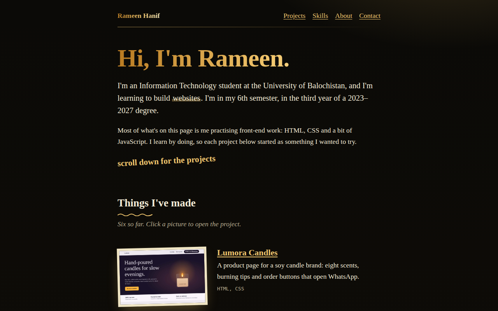
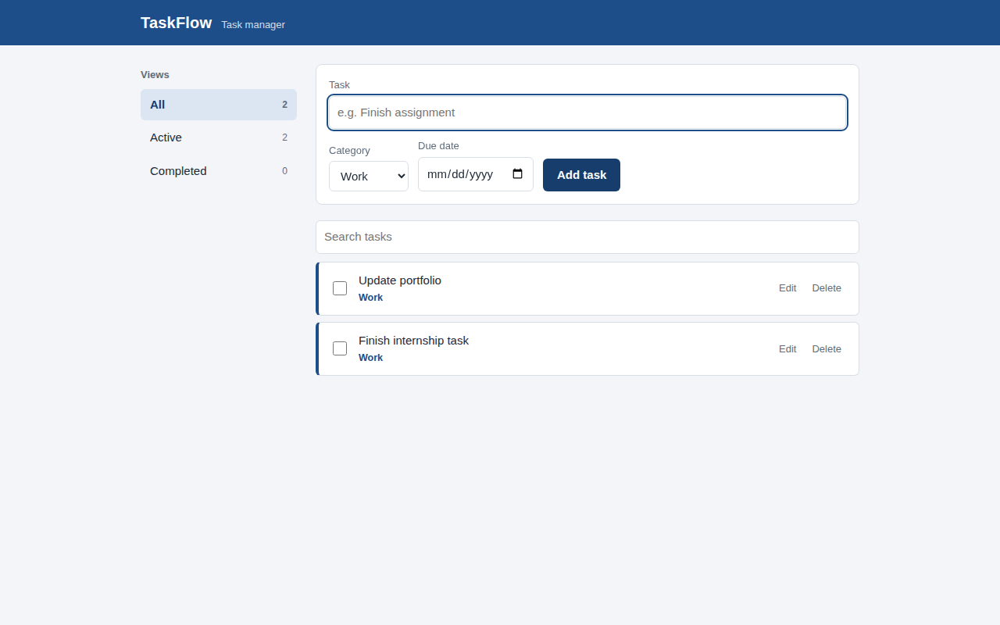

# Datheon Full Stack Web Development Internship

Project submission by **Rameen Hanif**, Information Technology student at the University of Balochistan (2023-2027), for the Datheon 2026 Engineering Cohort (4-week virtual internship).

This repository contains three projects built with HTML, CSS and JavaScript. All three run in the browser with no build step.

## Projects

| # | Folder | What it is | Built with |
|---|--------|------------|------------|
| 1 | [`01-developer-portfolio`](./01-developer-portfolio) | Responsive personal developer portfolio with six project pages | HTML, CSS |
| 2 | [`02-taskflow-task-manager`](./02-taskflow-task-manager) | Task manager with categories, due dates, search and filters | HTML, CSS, JavaScript, localStorage |
| 3 | [`03-skycast-weather-app`](./03-skycast-weather-app) | Weather app with a 5-day forecast and weather-based themes | HTML, CSS, JavaScript, OpenWeatherMap API |

### 1. Developer Portfolio
A responsive portfolio that lists six web projects (a candle product page, a travel guide, a UI component library, a timeline, a CSS art gallery and a retro terminal page) plus skills, about and contact sections.
Live version: https://portfolio-pearl-eta-8f61hvos84.vercel.app/



### 2. TaskFlow (Task Manager)
- Add, edit and delete tasks
- Categories (Work, Personal, Study) and due dates
- Filter by All, Active and Completed, with live counts
- Search tasks by text, and drag tasks to reorder them
- Overdue tasks are highlighted
- Tasks are saved in the browser with `localStorage`, so they stay after a refresh



### 3. Skycast (Weather App)
- Search any city, or tap a quick-pick city
- Current conditions plus a 5-day forecast, loaded with `fetch` and `async/await`
- Loading spinner and clear error messages for unknown cities, bad keys and server errors
- Responsive layout for phones and desktops
- Colour scene that changes with the weather
- Uses the OpenWeatherMap API. Without an API key it runs in **demo mode** with sample data, so it never breaks

## Repository structure

```
Datheon_Full_Stack_Web_Development_Internship/
|-- README.md
|-- index.html (start page linking to the three projects)
|-- screenshots/
|-- 01-developer-portfolio/
|   |-- index.html
|   `-- projects/ (six project pages)
|-- 02-taskflow-task-manager/
|   |-- index.html
|   |-- style.css
|   `-- script.js
`-- 03-skycast-weather-app/
    |-- index.html
    |-- style.css
    |-- script.js
    `-- images/
```

## How to run
1. Download or clone this repository.
2. Open the `index.html` file inside any project folder in a browser.
3. For live weather in Skycast, get a free key from https://openweathermap.org/api and paste it into `API_KEY` at the top of `03-skycast-weather-app/script.js`. Do not commit your real key to a public repository.

## Notes
These are front-end projects. Data is stored in the browser (TaskFlow) or fetched from a public API (Skycast). There is no custom back-end server.

## Author
**Rameen Hanif**
- Email: rameen.hanif.it@gmail.com
- GitHub: https://github.com/rameenhanifit-glitch
- Portfolio: https://portfolio-pearl-eta-8f61hvos84.vercel.app/
